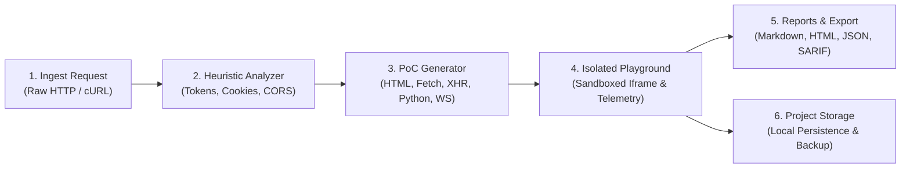
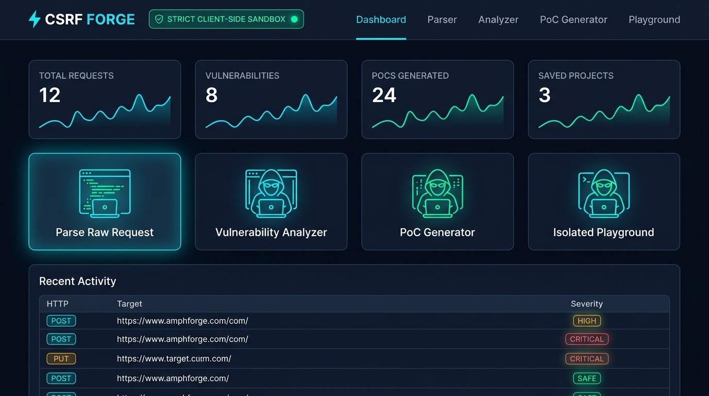
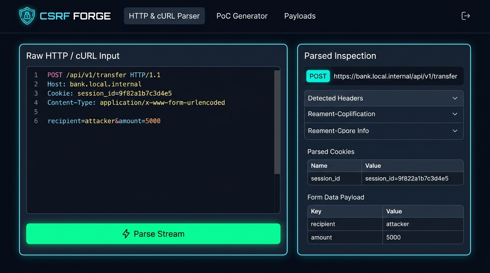
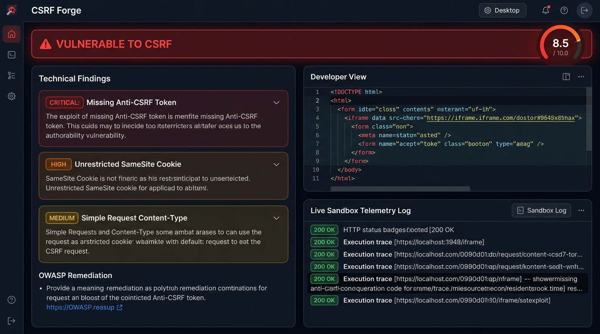

# ⚡ CSRF Forge

**Advanced CSRF Proof of Concept Generator & Vulnerability Analyzer**

A modern, high-performance, client-side cybersecurity tool for security engineers, penetration testers, and bug bounty hunters to evaluate Cross-Site Request Forgery (CWE-352 / OWASP Top 10 A01:2021) vulnerabilities, generate verified multi-vector proof-of-concept exploits, test them safely inside an isolated sandbox, and export comprehensive executive reports.


---

## 🌐 Live Application

- **Live Production URL**: [https://syedrakesh.github.io/csrf-forge/](https://syedrakesh.github.io/csrf-forge/)
- **100% Client-Side Privacy**: Runs completely in the browser. Zero network transmission of captured traffic, session tokens, or exploit code.

---

## 📖 Step-by-Step User Walkthrough

### System Architecture Flow



---

### Step 1: Central Operations Dashboard

The dashboard provides a high-level overview of your active testing session, security metrics, and direct module shortcuts.



1. **Session Metrics**: Tracks parsed requests, identified vulnerabilities, synthesized PoC artifacts, and stored projects.
2. **Security Status Indicator**: Displays the status of the **Strict Client-Side Sandbox** to guarantee safe browser execution.
3. **Quick Action Cards**: One-click navigation to Parse Raw Requests, Analyze Vulnerabilities, Generate PoCs, and Launch the Playground.
4. **Recent Activity Feed**: Real-time audit log with CVSS severity badges (`CRITICAL`, `HIGH`, `MEDIUM`, `LOW`, `SECURE`).

---

### Step 2: Ingesting HTTP & cURL Requests (Parser)

The Parser extracts HTTP transactions from security proxies (Burp Suite, OWASP ZAP, Postman) or terminal `curl` commands.



1. **Input Area**: Paste raw HTTP request streams or multiline `curl` commands.
2. **Built-in Sample Library**: Load real-world vulnerable request templates (Wire Transfer, Account Email Update, Admin Role Escalation, JSON text/plain bypass) with a single click.
3. **Structured Inspection View**: Automatically segments:
   - Target HTTP Method (`POST`, `PUT`, `DELETE`, `GET`)
   - Fully qualified URL endpoint
   - Parsed request headers with key-value normalization
   - Ambient cookies extraction (`Cookie`, `-b`, `--cookie`)
   - Form-urlencoded or JSON payload parameters
4. **Auto-Detection Engine**: Differentiates raw HTTP text from shell `curl` commands automatically.

---

### Step 3: Vulnerability Analysis & CVSS Risk Scoring

The Analyzer heuristically assesses your request parameters against standard cross-origin security rules.



1. **CVSS Risk Gauge**: Weighted 0.0 to 10.0 risk score based on finding severities.
2. **Heuristic Detection Rules**:
   - **Anti-CSRF Tokens**: Detects presence or absence of tokens in headers (`X-CSRF-Token`, `X-XSRF-Token`) and bodies (`csrf_token`, `authenticity_token`).
   - **Cookie Attributes**: Flags session cookies lacking `SameSite=Strict` or `SameSite=Lax`.
   - **Content-Type Preflight Relaxation**: Evaluates whether the request uses simple content types (`application/x-www-form-urlencoded`, `multipart/form-data`, `text/plain`) that execute without a CORS preflight (`OPTIONS`) request.
   - **Origin & Referer Validation**: Verifies source domain origin checks.
3. **Remediation Guides**: Actionable OWASP guidance for each finding (Synchronizer Token Pattern, Double Submit Cookie, Custom Headers).

---

### Step 4: Multi-Vector Exploit Generation

Generate reliable proof-of-concept exploits tailored to target endpoint architectures:

| Exploit Vector | Target Architecture | Implementation Mechanism |
|---|---|---|
| **HTML Auto-Submit** | Form POST / GET | Hidden inputs with automatic submission targeting a hidden iframe |
| **Fetch API** | Modern Web APIs | `fetch(url, { method: 'POST', credentials: 'include' })` |
| **XMLHttpRequest** | Classic Web 2.0 / AJAX | `xhr.withCredentials = true` cross-origin state alteration |
| **GET Image Beacon** | State-changing GETs | Zero-interaction `` tag execution |
| **JSON Plaintext Trick** | Lax JSON Endpoints | Form `enctype="text/plain"` to transmit JSON payloads |
| **CSWSH (WebSocket)** | Real-time WebSockets | Cross-Site WebSocket Hijacking payload (`ws://`, `wss://`) |
| **Python 3 Script** | CI / Regression Testing | Standalone reproduction script using `requests.Session()` |

#### Advanced Attack Configuration:
- **Auto-Submit & Execution Delay**: Configurable execution timer (0–5000 ms) or manual button submission.
- **Stealth Iframe Redirection**: Targets submissions to an invisible `<iframe>` to suppress navigation and conceal the attack.
- **Cookie & CRLF Pre-Flight Injection**: Directly embeds pre-flight triggers (e.g. ``, `onload`, or `fetch()`) to set or toss cookies (such as in PortSwigger Web Security Academy labs where tokens are tied to non-session cookies) before the CSRF payload fires.

---

### Step 5: Isolated Execution Playground

Verify PoC exploits safely inside the browser without exposing your session:

1. **Strict Iframe Sandbox**: Uses `sandbox="allow-scripts allow-forms"`, strictly omitting `allow-same-origin` to ensure the host application cannot be compromised.
2. **Real-time Telemetry Interception**: Intercepts dispatched form submissions, network calls, and console events, streaming them to a live cyber event log.

---

### Step 6: Vulnerability Reporting & Project Management

Compile professional, client-ready security audit deliverables:

1. **Export Formats**:
   - **Executive Markdown (`.md`)**: GitHub/Bug-bounty ready audit report with CVSS breakdown and remediation guides.
   - **Standalone Client HTML (`.html`)**: Self-contained, styled pentest report ready for client presentation or print-to-PDF (`window.print()`).
   - **Structured JSON (`.json`)**: Machine-readable schema compatible with DefectDojo and OWASP ASVS.
   - **OASIS SARIF (`.sarif`)**: Industry-standard format for direct import into GitHub Code Scanning and CI pipelines.
2. **Local Project Storage**:
   - Save multi-request testing sessions locally in your browser with zero external database dependencies.
   - One-click JSON backup export and import for project archiving and sharing.

---

## 🚀 Quick Start

### Prerequisites
- Node.js 20.x or higher
- npm 10.x or higher

### Installation
```bash
git clone git@github.com:syedrakesh/csrf-forge.git
cd csrf-forge
npm install
```

### Development Server
```bash
npm run dev
```

### Full Validation Suite
```bash
npx tsc --noEmit
npm run lint
npm run test:run
npm run build
```

---

## 🏗️ Architecture

```
src/
├── components/           # Reusable UI & Layout Components
│   ├── layout/          # Header, Sidebar, Main Layout
│   └── ui/              # Badge, Button, Card, CodeBlock, StatCard, Tabs, Alert, Modal
├── context/             # React Context & Session Persistence
│   ├── AppContext.tsx   # Provider with sessionStorage sync
│   ├── context.ts       # Context definition
│   └── useApp.ts        # Type-safe hook
├── lib/                 # Core Engine Libraries
│   ├── parser/          # Raw HTTP and cURL tokenizers & detectors
│   ├── analyzer/        # Heuristic rules & CVSS scoring
│   ├── generator/       # HTML, Fetch, XHR, Image, Python, WebSocket generators
│   ├── playground/      # Telemetry injection and sandbox runtime
│   ├── storage/         # LocalStorage persistence & templates
│   └── reports/         # Markdown, HTML, JSON, and SARIF report compilers
├── pages/               # Application Route Views
│   ├── Dashboard.tsx    # Operational metrics & quick actions
│   ├── ParserPage.tsx   # HTTP / cURL stream ingestion
│   ├── AnalyzerPage.tsx # CSRF vulnerability findings
│   ├── GeneratorPage.tsx# Exploit compilation
│   ├── PlaygroundPage.tsx# Isolated testing sandbox
│   ├── ProjectsPage.tsx # Local project manager
│   ├── ReportsPage.tsx  # Executive vulnerability export
│   └── NotFound.tsx     # 404 error handler
└── test/                # Unit, UI, and E2E Test Suites (142+ Tests)
```

---

## 🔒 Security & Privacy Notice

CSRF Forge is engineered as an authorized defensive security auditing suite.
- **Client-Side Execution**: All inputs remain in the browser; no telemetry or user data is transmitted to external servers.
- **Strict Sandboxing**: The playground sandbox runtime isolates PoC code inside an unprivileged iframe context without same-origin access.
- **Responsible Use**: Use this tool only on web systems and applications you have explicit authorization to assess.

---

## 📄 License

MIT License &copy; 2026 Syed Rakesh.
